# Mini-Git Architecture & Design Specification

> **C++17 Command-Line Version Control System & Visual Web Studio**

---

## Table of Contents
1. [Layered Overview](#1-layered-overview)
2. [Class Responsibilities](#2-class-responsibilities)
3. [Relationships & UML Mapping](#3-relationships--uml-mapping)
4. [On-Disk Layout (`.minigit/`)](#4-on-disk-layout-minigit)
5. [Top-Level Control Flow](#5-top-level-control-flow)
6. [Command Flowcharts](#6-command-flowcharts)
   - [init](#61-flowchart-minigit-init)
   - [add](#62-flowchart-minigit-add-path)
   - [commit](#63-flowchart-minigit-commit--m-msg)
   - [status](#64-flowchart-minigit-status)
   - [diff](#65-flowchart-minigit-diff-file)
   - [branch & checkout](#66-flowchart-minigit-branch--checkout)
   - [merge](#67-flowchart-minigit-merge-branch--minigit-merge---abort)
7. [Object Graph Evolution](#7-object-graph-evolution)
8. [OOP & C++ Concept Map](#8-oop--c-concept-map)
9. [Second Frontend: Web Studio (`minigit html`, `minigit ui`)](#9-second-frontend-web-studio-minigit-html-minigit-ui)
   - [Web Security Model](#web-security-model)
   - [Web Studio Features & Implementation](#web-studio-features--implementation)
10. [More Diagrams](#10-more-diagrams)

---

## 1. Layered Overview

Mini-Git is organized into three decoupled layers: **Frontends (CLI and Web Studio)**, **Backend Facade (`Repository`)**, and **Storage Subsystems (`.minigit/`)**.

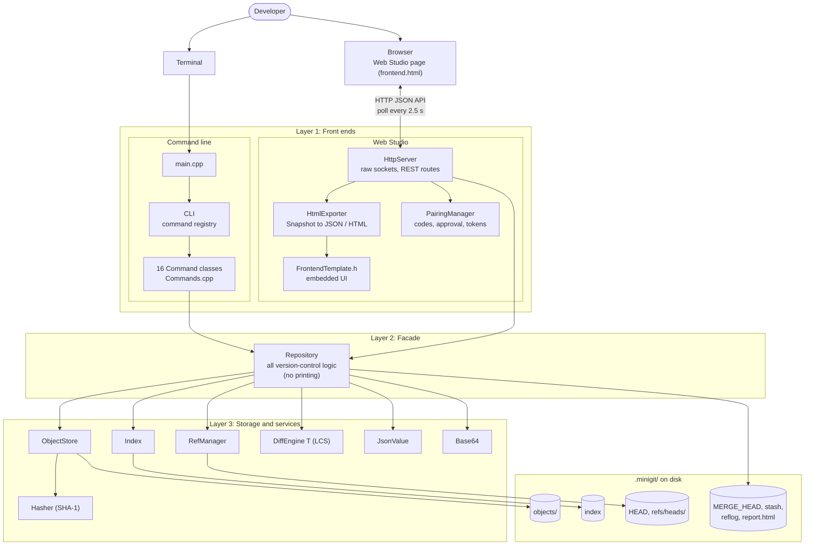

| Layer | Components | Responsibility |
|---|---|---|
| **Frontend** | `main.cpp`, `CLI`, `Command` hierarchy; `HttpServer`, `HtmlExporter`, `PairingManager`, embedded web UI | Parses arguments or HTTP requests, prints output or returns JSON, catches exceptions. |
| **Backend Facade** | `Repository` | Contains all business logic, never prints to `stdout`/`stderr`, owns storage abstractions. |
| **Storage Subsystems** | `ObjectStore`, `Index`, `RefManager` (plus helpers `Hasher`, `DiffEngine<T>`, `JsonValue`, `Base64`) | Reads and writes immutable objects, staging index, and branch references under `.minigit/`. |

---

## 2. Class Responsibilities

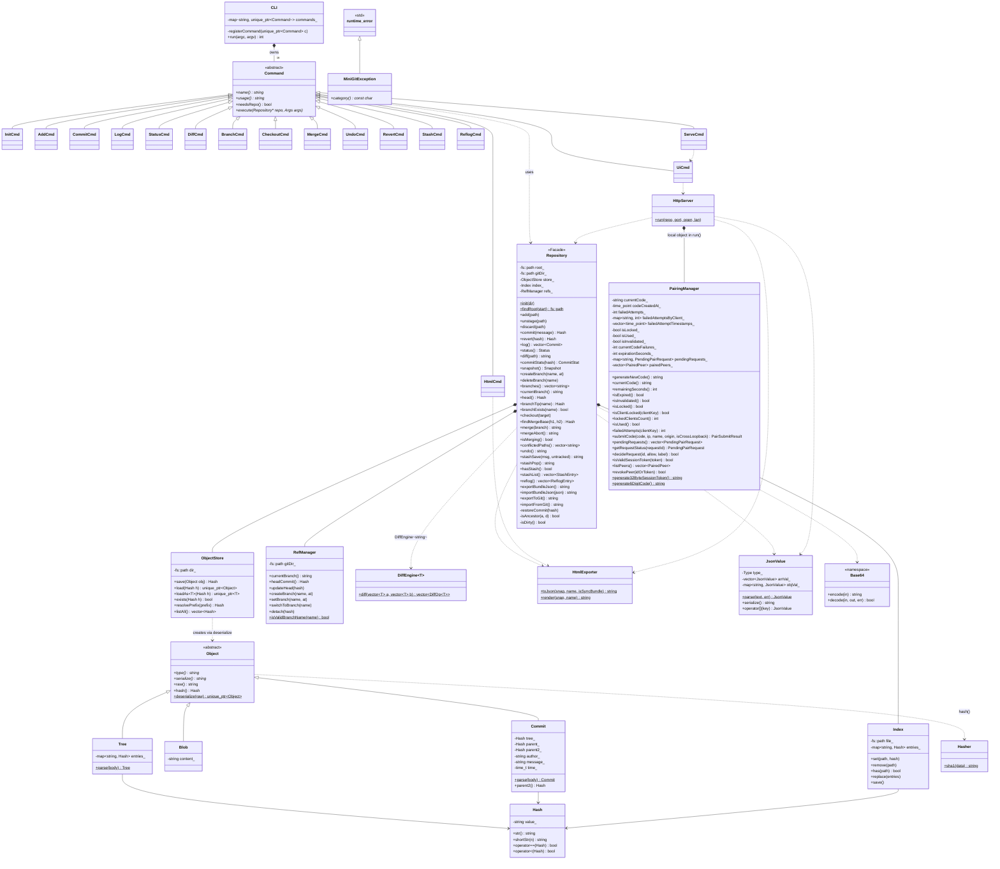

The exception classes are drawn separately in [docs/diagrams/exceptions.md](docs/diagrams/exceptions.md).

### Core Data & Object Models
- **`Hash`**: Value type wrapping a 40-character hexadecimal SHA-1 digest. Overloads `==`, `!=`, `<`, and `<<`.
- **`Hasher`**: SHA-1 cryptographic engine implementing the Merkle-Damgård construction.
- **`Object`** *(Abstract Base)*: Defines `type()`, `serialize()`, `hash()`, and factory `deserialize()`.
  - **`Blob`**: Stores raw uncompressed file contents.
  - **`Tree`**: Maps relative file paths to `Hash` identifiers (`map<string, Hash>`), representing snapshot directories.
  - **`Commit`**: Encapsulates a root `Tree` hash, parent commit `Hash`, an optional second parent `parent2` (merge commits only), author string, timestamp, and log message.

### Engine Services
- **`ObjectStore`**: Content-addressable object store located at `.minigit/objects/`. Implements template method `loadAs<T>()` and prefix resolver `resolvePrefix()` for short hashes.
- **`Index`**: Staging area manager mapping relative paths to staged blob hashes; synchronizes with `.minigit/index`.
- **`RefManager`**: Manages `.minigit/HEAD` and `.minigit/refs/heads/` (supporting attached branches and detached HEAD).
- **`DiffEngine<T>`** *(Template)*: Computes Longest Common Subsequence (LCS) line diffs, producing `DiffOp` operations (`Keep`, `Add`, `Remove`).
- **`Repository`**: Central facade pattern mediating all version control operations.
- **`Status`**: Struct packaging lists of `staged`, `modified`, `deleted`, and `untracked` paths.
- **`Snapshot`**: Complete read-only memory capture of repository state (objects, branches, working files, index).
- **`HtmlExporter`**: Converts a `Snapshot` into JSON (or a sync bundle with Base64 binaries) and injects it into the embedded web UI.
- **`HttpServer`**: Socket-based local server for the Web Studio REST API; binds to 127.0.0.1, or 0.0.0.0 with `--lan`.
- **`PairingManager`**: 6-digit pair codes, host approval, session tokens and revocation for LAN sync.
- **`JsonValue`** / **`Base64`**: Hand-written JSON parser/serialiser and Base64 codec used by the API and sync bundles.

### Commands & Dispatcher
- **`Command`** *(Abstract Base)*: Declares `name()`, `usage()`, `needsRepo()`, and `execute(repo, args)`.
- **`CLI`**: Registry storing `map<string, unique_ptr<Command>>` dispatching command execution.
- **`MiniGitException`** *(Exception Base)*: Provides `virtual category()` caught uniformly by `CLI::run`.

---

## 3. Relationships & UML Mapping

- **Inheritance**:
  - `Blob`, `Tree`, `Commit` $\rightarrow$ `Object`
  - Concrete commands (`InitCmd`, `AddCmd`, `CommitCmd`, `LogCmd`, `StatusCmd`, `DiffCmd`, `BranchCmd`, `CheckoutCmd`, `MergeCmd`, `UndoCmd`, `RevertCmd`, `StashCmd`, `ReflogCmd`, `HtmlCmd`, `UiCmd`, `ServeCmd`) $\rightarrow$ `Command`
  - Custom exceptions (`NotARepoException`, `FileNotFoundException`, `InvalidObjectException`, `BranchException`, `NothingToCommitException`, `CheckoutException`, `MergeException`) $\rightarrow$ `MiniGitException` $\rightarrow$ `std::runtime_error`
- **Composition**:
  - `Repository` owns `ObjectStore`, `Index`, `RefManager`
  - `CLI` owns `map<string, unique_ptr<Command>>`
  - `HttpServer::run` owns a local `PairingManager`
- **Association**:
  - `Tree` associates with `Hash` (blob identifiers)
  - `Commit` associates with `Hash` (tree & parent commit)
  - `Index` associates with `Hash` (staged blob IDs)
- **Dependency**:
  - `Repository` $\rightarrow$ `DiffEngine<string>`, `Blob`, `Tree`, `Commit`, `Snapshot`
  - `HtmlCmd` $\rightarrow$ `HtmlExporter`, `Repository`, `Snapshot`
  - `UiCmd` $\rightarrow$ `HttpServer` $\rightarrow$ `Repository`, `PairingManager`, `HtmlExporter`, `JsonValue`
  - `Repository` $\rightarrow$ `JsonValue`, `Base64` (sync bundles)
  - `ObjectStore` $\rightarrow$ `Object` (instantiates through `Object::deserialize`)

---

## 4. On-Disk Layout (`.minigit/`)

```text
.minigit/
├── HEAD                 "ref: refs/heads/main"  (or raw hash when detached)
├── index                "<blobhash> <filepath>" (one line per staged entry)
├── MERGE_HEAD           other branch's tip while a conflicted merge is unfinished
├── stash                one line per stash: <commit> <index tree> <message>
├── reflog               time|action|old|new|description, one line per HEAD move
├── report.html          page written by `minigit html`
├── refs/
│   └── heads/
│       ├── main         latest 40-char commit hash on 'main'
│       └── feature      latest 40-char commit hash on 'feature'
└── objects/
    ├── 7f59f3...        Blob:   "blob\n<raw file content>"
    ├── a91c02...        Tree:   "tree\n<blobhash> <filepath>\n..."
    └── e1dfc6...        Commit: "commit\ntree <treehash>\nparent <parenthash>\n[parent2 <hash>]\nauthor ...\ntime ...\n\n<message>"
```

> [!NOTE]
> Every object is addressed by the SHA-1 hash of its header and body: `SHA-1(type + "\n" + content)`.

---

## 5. Top-Level Control Flow

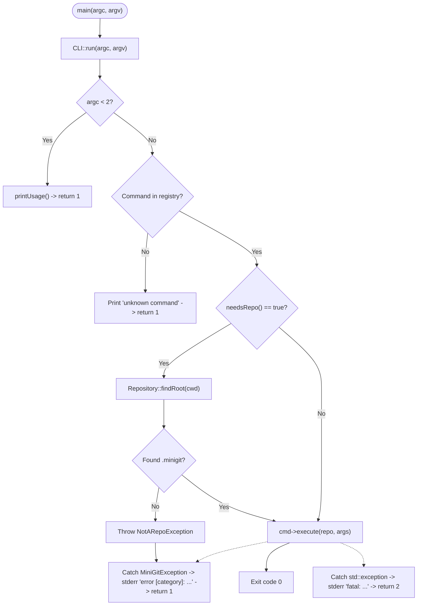

---

## 6. Command Flowcharts

### 6.1 Flowchart: `minigit init`

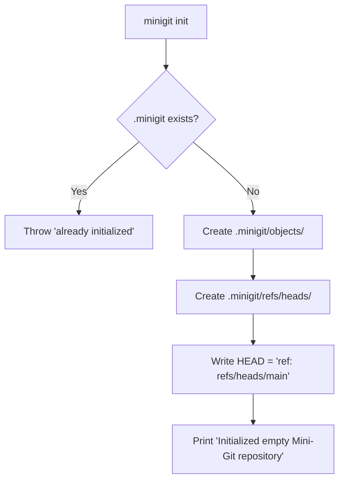

---

### 6.2 Flowchart: `minigit add <path>`

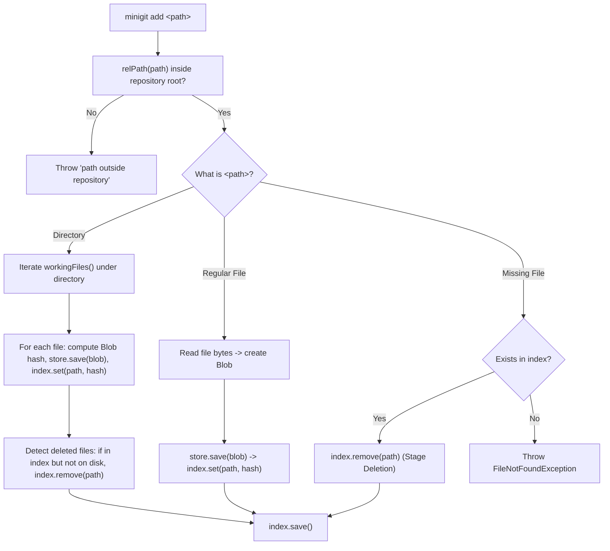

---

### 6.3 Flowchart: `minigit commit -m "msg"`

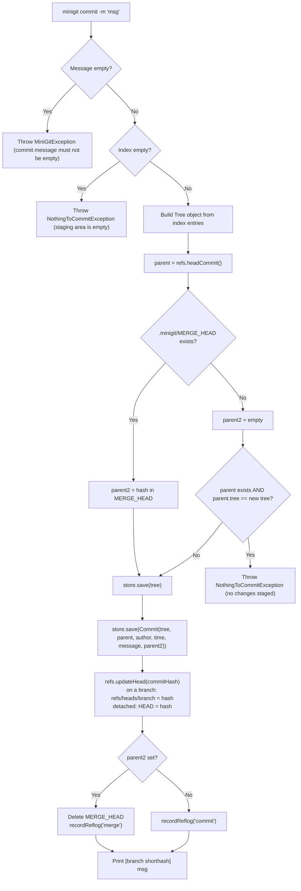

- A commit made while `MERGE_HEAD` exists finishes a conflicted merge: it gets two parents even if the tree equals the parent's tree.
- The author comes from `MINIGIT_AUTHOR`, then `USER` / `USERNAME`, else `unknown`.

---

### 6.4 Flowchart: `minigit status`

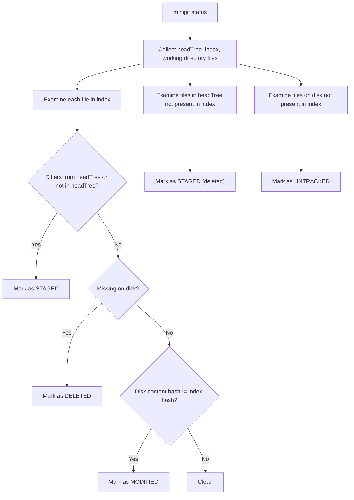

---

### 6.5 Flowchart: `minigit diff [file]`

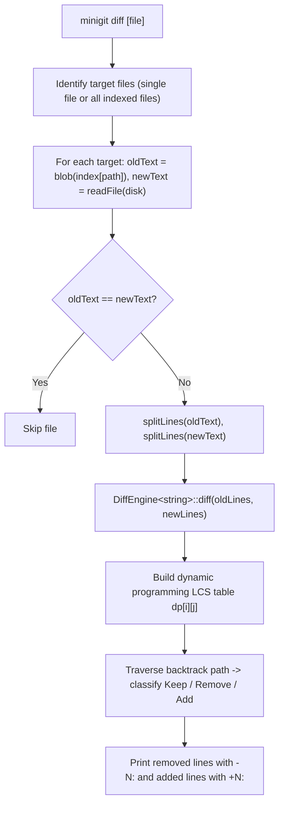

---

### 6.6 Flowchart: `minigit branch` & `checkout`

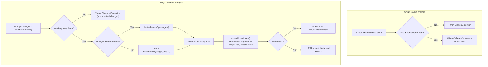

---

### 6.7 Flowchart: `minigit merge <branch>` / `minigit merge --abort`

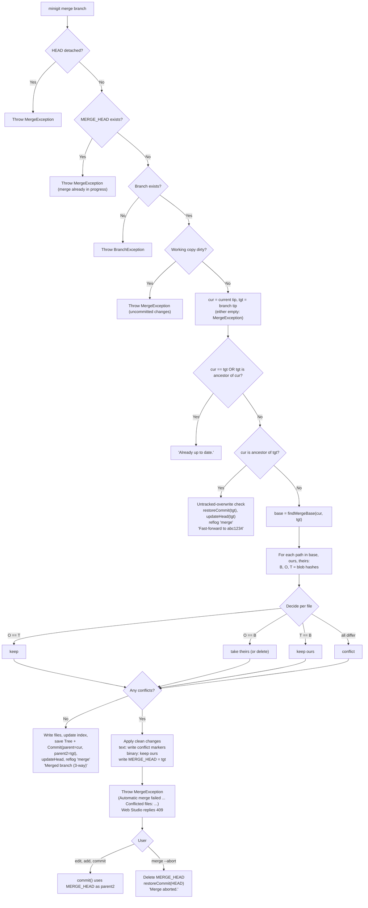

Conflict markers in a text file:

```text
<<<<<<< ours
our version
=======
their version
>>>>>>> feature
```

- The merge base is found with a breadth-first search over `parent` and `parent2` links.
- `merge --abort` fails with `no merge in progress to abort` when there is no `MERGE_HEAD`.

---

## 7. Object Graph Evolution

Commit trees represent full snapshots. Unchanged files reuse existing blob hashes:

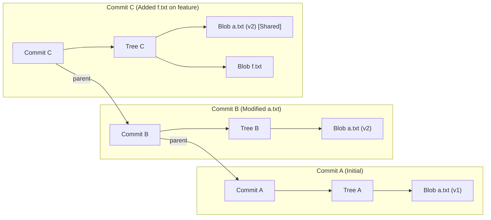

---

## 8. OOP & C++ Concept Map

| Concept | Implementation in Mini-Git |
|---|---|
| **Encapsulation** | Strict private members with accessors in `Commit`, `Hash`, `Index`, `RefManager`, and `Repository`. |
| **Inheritance** | Polymorphic hierarchies: `Object` (`Blob`, `Tree`, `Commit`), `Command` (16 concrete commands), and `MiniGitException`. |
| **Polymorphism** | Dynamic dispatch via pure virtual methods (`execute()`, `serialize()`, `type()`, `category()`). |
| **Abstract Classes** | `Object` and `Command` enforce interface contracts via pure virtual methods (`= 0`). |
| **Templates** | Generic LCS algorithm `DiffEngine<T>` and type-safe object loading `ObjectStore::loadAs<T>()`. |
| **Exception Safety** | Structured error propagation throwing domain exceptions in the backend, caught once in `CLI::run`. |
| **Operator Overloading** | Canonical relational operators (`==`, `!=`, `<`) on `Hash` and stream output `<<` for `Hash` and `Commit`. |
| **Modern Memory Management** | Zero raw pointers/manual deletions; strict RAII utilizing `std::unique_ptr` throughout. |
| **Modern File I/O** | Portable filesystem manipulation using `std::filesystem` and robust stream utilities. |
| **Design Patterns** | **Command Pattern** (`CLI` & `Command`), **Facade Pattern** (`Repository`), and **Factory Pattern** (`Object::deserialize`). |

---

## 9. Second Frontend: Web Studio (`minigit html`, `minigit ui`)

Both commands use the same embedded page (`templates/frontend.html`, compiled into `include/FrontendTemplate.h`) and the same backend.

```mermaid
flowchart TD
    subgraph Static ["minigit html [--no-open]"]
        H1["HtmlCmd::execute()"] --> H2["Repository::snapshot()"]
        H2 --> H3["HtmlExporter::render(): snapshot JSON injected into page"]
        H3 --> H4["Write .minigit/report.html, open browser"]
    end

    subgraph Live ["minigit ui / serve [--port N] [--no-open] [--lan]"]
        U1["UiCmd::execute()"] --> U2["HttpServer::run(repo, port, open, lan)"]
        U2 --> U3["Bind 127.0.0.1 (0.0.0.0 with --lan)<br/>try port .. port+29"]
        U3 --> U4["Accept loop: parse request, validate Host & Origin, route"]
        U4 --> U5["GET / : rendered page"]
        U4 --> U6["/api/snapshot : ETag conditional check<br/>(304 Not Modified or 200 OK + snapshot)"]
        U4 --> U7["/api/* : call Repository,<br/>reply with JSON + fresh snapshot"]
        U4 --> U8["/api/pair* : PairingManager"]
        U4 --> U9["/api/sync/* : exportBundleJson / importBundleJson"]
        U4 --> U10["/api/git/* : exportToGit / importFromGit"]
    end

    subgraph Browser ["Browser page (Fetch API)"]
        B1["Files, editor, staging, commit, delete"]
        B2["Branches, merge conflict banner, revert, undo"]
        B3["Stash, reflog, time travel"]
        B4["Lane-based DAG graph, dashboard mini DAG"]
        B5["Pair panel, pull / push, Git Bridge"]
    end

    H4 --> Browser
    U5 --> Browser
    Browser -->|"fetch, poll /api/snapshot (If-None-Match: ETag)"| U6
    U6 -->>|"304 Not Modified (empty) or 200 OK + new snapshot + ETag"| Browser
    Browser -->|"POST /api/* (JSON body, CSRF/Origin check)"| U7
```

**REST API (`HttpServer.cpp`)**

Every API endpoint enforces strict access levels:
- **Loopback only**: Accessible strictly from `127.0.0.1` / `localhost`. Calls from non-loopback clients return `403 Forbidden`. State-changing POST requests enforce same-origin verification and `Content-Type: application/json`.
- **LAN (public)**: Requires server to be started with `--lan`. Reachable by LAN peers; subject to brute-force rate limits and client lockouts.
- **LAN + Token**: Requires server `--lan` and a valid session token passed via `X-MiniGit-Token` header. Missing or invalid tokens return `401 Unauthorized`. Loopback clients from local origin are exempt on export.

| Method | Endpoint | Access Level | Description |
|---|---|---|---|
| `GET` | `/` or `/index.html` | Loopback only | Serves the interactive Web Studio single-page application. |
| `GET` | `/api/snapshot` | Loopback only | Returns full repository snapshot JSON with `ETag`. Supports `If-None-Match` returning `304 Not Modified`. |
| `GET` | `/api/token` | Loopback only | Returns current pair code, remaining countdown, lockout state, and LAN URL. |
| `GET` | `/api/pair/code` | Loopback only | Returns pair code status, remaining seconds, lockout flags, and failure counts. |
| `POST` | `/api/pair/generate-code` | Loopback only | Generates a new 6-digit CSPRNG pair code; resets failed attempt counters. |
| `POST` | `/api/pair` | LAN (public) | Submits 6-digit pair code for host approval (`code`, `peerName`). Returns `requestId`. Locked after 5 bad attempts with exponential backoff (403); rate limited at 10 fails/min across clients (429); unauthenticated bodies capped at 4 KB. |
| `GET` | `/api/pair/status` | LAN (public) | Polled by peer (`?requestId=...`) to retrieve approval decision and session token (delivered once to requesting IP, then deleted). |
| `GET` | `/api/pair/pending` | Loopback only | Polled by host every 1.5 s to display pending pairing requests (< 120s old). |
| `POST` | `/api/pair/decide` | Loopback only | Host allows or denies pairing (`requestId`, `allow`, optional custom label). Issues 32-byte session token on approval. |
| `GET` | `/api/pair/peers` | Loopback only | Lists all currently paired peers (IDs, IPs, labels, timestamps). |
| `POST` | `/api/pair/revoke` | Loopback only | Revokes access for a paired peer by ID or token. |
| `POST` | `/api/file/save`, `/api/file/write` | Loopback only | Writes content to a file in the working tree (`path`, `content`). |
| `POST` | `/api/file/delete` | Loopback only | Deletes a file from the working tree and removes it from staging if staged. |
| `POST` | `/api/stage` | Loopback only | Stages changes for a path (`path: "."` stages all changes). |
| `POST` | `/api/unstage` | Loopback only | Unstages changes for a path (`path: "."` unstages all). |
| `POST` | `/api/discard` | Loopback only | Reverts working tree changes to staged/HEAD state, or deletes untracked file. |
| `POST` | `/api/commit` | Loopback only | Creates a new commit from staged changes (`message`). |
| `POST` | `/api/branch/create` | Loopback only | Creates a new branch (`name`, optional `at` commit hash). |
| `POST` | `/api/branch/delete` | Loopback only | Deletes an existing branch (`name`). |
| `POST` | `/api/checkout` | Loopback only | Switches branch or checks out a commit hash in detached HEAD mode (`target`). |
| `POST` | `/api/merge` | Loopback only | Merges target branch (`branch`), or aborts an active merge (`abort: true`). |
| `POST` | `/api/revert` | Loopback only | Creates an atomic revert commit undoing specified commit (`hash`). |
| `POST` | `/api/undo` | Loopback only | Undoes the last commit via reflog, preserving working copy modifications. |
| `POST` | `/api/stash/save` | Loopback only | Stashes uncommitted changes (`message`, optional `includeUntracked`). |
| `POST` | `/api/stash/pop` | Loopback only | Pops most recent stash into working tree; refuses if conflicts occur. |
| `GET` | `/api/stash/list` | Loopback only | Lists all saved stash entries with index and descriptions. |
| `GET` | `/api/reflog` | Loopback only | Returns chronological history of HEAD movements and actions. |
| `POST` | `/api/reflog/restore` | Loopback only | Restores HEAD to a specific historical reflog commit (`hash`). |
| `GET` | `/api/sync/bundle` | LAN + Token | Exports full repository snapshot bundle as JSON. Local loopback origin is exempt from token. |
| `POST` | `/api/sync/import-bundle` | LAN + Token | Verifies and imports JSON bundle objects and branches into repository. |
| `GET` | `/api/git/status` | Loopback only | Checks standard Git repository presence and bridge readiness. |
| `POST` | `/api/git/export` | Loopback only | Exports current repository snapshot to standard Git repository. |
| `POST` | `/api/git/import` | Loopback only | Imports current working directory into Mini-Git commit. |

### Web Security Model

The Web Studio implements defense-in-depth security hardening against common web and local network attack vectors:

- **Loopback binding by default**: The HTTP server binds exclusively to `127.0.0.1` unless explicitly started with `--lan` (which binds to `0.0.0.0`). Non-loopback network traffic is rejected at the socket layer when `--lan` is not active.
- **Host-header validation (DNS rebinding defense)**: Every HTTP request validates the `Host` header against the bound port and permitted hostnames (`127.0.0.1`, `localhost`, or IPv4 literal when `--lan` is enabled). Requests with unrecognized or external host headers are rejected with `403 Forbidden`, preventing DNS rebinding exploits from executing unauthorized local actions.
- **Origin / CSRF validation**: All state-changing HTTP requests (`POST`, `PUT`, `DELETE`) arriving over loopback verify that the `Origin` header matches `http://127.0.0.1:<port>` or `http://localhost:<port>`. Malicious cross-origin requests from external web pages are blocked with `403 Forbidden`. Cross-origin pairing over loopback is strictly prohibited.
- **JSON Content-Type requirement**: State-changing loopback endpoints require `Content-Type: application/json` (returning `400 Bad Request` if omitted). This prevents simple cross-site HTML form submissions (`application/x-www-form-urlencoded` or `multipart/form-data`) from triggering repository mutations.
- **Token-protected sync endpoints**: Non-loopback access to sync endpoints (`/api/sync/bundle` and `/api/sync/import-bundle`) requires a valid 32-byte cryptographic session token in the `X-MiniGit-Token` header. Missing, invalid, or revoked tokens return `401 Unauthorized`. All non-sync, non-pairing endpoints return `403 Forbidden` to external clients.
- **Slowloris & timeout protection**: Enforces a strict 10-second per-request deadline using polling against a wall-clock deadline. Inbound connections are served via `HttpServerThreadPool`, with mutex protection (`repoMutex`, `pairingMutex`) safeguarding shared backend state.
- **Unauthenticated endpoint body limit (4 KB)**: Inbound request bodies on unauthenticated endpoints (`/api/pair`, `/api/pair/status`) are capped at 4 KB prior to JSON parsing.
- **Payload size limit (50 MB)**: Request bodies are capped at 50 MB via `Content-Length` enforcement (`> 50 * 1024 * 1024`). Excessive payloads are rejected immediately with `413 Payload Too Large`.
- **JSON nesting depth limit**: JSON parser enforces a maximum nesting depth of 64 levels, preventing stack exhaustion on adversarial inputs.
- **Process execution security**: Removed all `std::system()` calls; browser opening and Git bridge commands invoke executable binaries using explicit argv arrays (`CreateProcess` on Windows, `fork`/`execvp` on POSIX).
- **Symlink and path traversal protection**: Working tree scans skip symlinks via `symlink_status`, and all path writes/deletions verify `ensureNoSymlinkComponents` to prevent traversal through symlinked parent components.
- **Path traversal and input validation**: All repository paths are canonicalized through `Repository::resolveRepoPath`:
  - Paths cannot be empty, `.`, or `..`.
  - Absolute paths are strictly rejected.
  - Paths escaping the repository boundary (via `..` lexical resolution) throw exceptions.
  - Internal `.minigit` files and directories cannot be read or written.
  - Filenames containing illegal filesystem characters (`\`, `:`, `*`, `?`, `"`, `<`, `>`, `|`, or control characters) are rejected.
  - Branch names imported from sync bundles are validated via `RefManager::isValidBranchName` (rejecting `..`, control characters, or `peer-` prefixes).
  - Every object in imported bundles (blobs, trees, commits) has its SHA-1 recomputed and verified before any object is written to disk. If any object hash fails verification, the bundle is rejected and references remain untouched.

### Web Studio Features & Implementation

- **Frontend communication**: The Studio uses the native **Fetch API** (`async fetch()` with JSON payloads, i.e. modern AJAX) for all client-server communication. It does not use `XMLHttpRequest` or external libraries like jQuery.
- **Conditional ETag / 304 polling**: The browser polls `/api/snapshot` every 2.5 seconds using standard HTTP caching: requests send `If-None-Match` containing the last received snapshot version `ETag`. If no repository changes occurred, the server responds with `304 Not Modified` and zero body bytes, eliminating unnecessary data transfer and DOM re-renders. Host pending pair requests are polled every 1.5 seconds.
- **Commit graph DAG visualizer**:
  - **Topological ordering**: Commits are arranged in topological order (newest to oldest, respecting parent-child relationships, timestamps, and HEAD).
  - **Lane-based branch layout**: Each active branch is assigned a distinct colored lane (`DAG_PALETTE`) with intelligent lane reuse to prevent collisions.
  - **Merge commits**: Render curved SVG bezier edges joining two parent lanes, with inner dot indicators identifying merge points.
  - **Unreachable commit toggle**: Commits not reachable from any current branch tip or HEAD (e.g. after undo, branch deletion, or detached reset) are tracked. An interactive SVG badge (`👁 Show N unreachable commit(s)` / `✕ Hide N unreachable commit(s)`) allows toggling their visibility, rendered with dashed borders and connections.
  - **Dashboard mini graph**: A compact horizontal DAG graph on the main dashboard visualizes the repository's topology and recent history at a glance.
- **Interactive merge conflict banner**: When a merge results in conflicts (`isMerging()` is true), a prominent top banner appears detailing unmerged paths. Each conflicting file includes a direct editor link and a **Mark Resolved** button (staging the file), alongside an **Abort merge** button that cleanly cancels the merge and restores previous state.
- **Unsaved-changes protection**:
  - Switching branches with dirty editor buffers opens an interactive modal offering **Save**, **Discard**, or **Cancel** (where Cancel aborts the switch without altering the active branch, and Discard clears dirty buffers only after checkout succeeds).
  - Staging individual files, staging all, or committing while unsaved edits exist prompts for user confirmation.
- **Caret preservation on refresh**: When the background polling updates active editor content, the editor captures `selectionStart` and `selectionEnd` and restores the selection range, ensuring typing is never interrupted.
- **File deletion**: Files can be deleted directly from the Web Studio via the editor toolbar delete button or the file tree action, calling `POST /api/file/delete` and removing any dirty buffer entries.
- **Branch at any commit**: From the commit detail view or commit graph, users can create a new branch pointing directly to any historical commit (`POST /api/branch/create` with `at` hash parameter).
- **Detached-HEAD badge**: When HEAD is detached, the branch dropdown displays `(detached at <hash>)`, the dashboard displays a detached badge, and the commit graph labels the active commit with a distinct `HEAD` badge.
- **Read-only binary files**: Binary files (containing NUL bytes) display `"binary file, not shown"` and lock the editor in `readOnly` mode to avoid accidental corruption.
- **P2P button loading states**: Pull and Push buttons display spinning notch icons (`fa-circle-notch fa-spin`), show real-time labels ("Pulling...", "Pushing..."), and disable duplicate clicks while sync operations are active.
- **Pairing security**:
  - 6-digit pair code generated using CSPRNG (`std::random_device`), valid for **300 seconds** (5 minutes), single-use upon host approval.
  - Host approval modal displays the requester's **IP address**, **Origin**, **claimed name**, and the **code entered**.
  - **Per-client lockout**: 5 failed code attempts lock out that client IP (`403 Forbidden`) with exponential backoff (starting at 5 seconds) until a new code is generated on the host. Other clients remain unaffected.
  - **Global rate limit**: 10 failed attempts across all clients within 60 seconds triggers `429 Too Many Requests`.
  - **DoS resilience without global code invalidation**: Malicious wrong attempts cannot lock out other legitimate clients globally. The host can manually click **Generate New Code** at any time.
  - Approving a request generates a 32-byte CSPRNG session token (64 hex characters) delivered once to the requesting client IP and then deleted from pending requests.
  - Host can view paired peers and revoke any token at any time.
- **Static vs live**: `minigit html` writes a standalone snapshot to `.minigit/report.html`; `minigit ui` is interactive and all operations execute through `Repository`.
- **Hashing**: Real repositories use C++ SHA-1 `Hasher`. Offline browser-only demo mode simulates hashing via the Web Crypto API.

---

## 10. More Diagrams

Each diagram below has its own page in [`docs/diagrams/`](docs/diagrams/README.md), with a PNG copy in `docs/diagrams/png/`.

- [Architecture Diagram](docs/diagrams/architecture.md)
- [Class Diagram (UML)](docs/diagrams/class-diagram.md)
- [Exception Hierarchy](docs/diagrams/exceptions.md)
- [Object Model](docs/diagrams/object-model.md)
- [Sequence Diagram: Commit](docs/diagrams/sequence-commit.md)
- [Activity Diagram: Merge](docs/diagrams/activity-merge.md)
- [Sequence Diagram: LAN Pairing and Sync](docs/diagrams/sequence-pairing-sync.md)
- [Deployment Diagram](docs/diagrams/deployment.md)
- [Use-Case Diagram](docs/diagrams/use-case.md)
- [State Diagrams](docs/diagrams/state-diagram.md)
