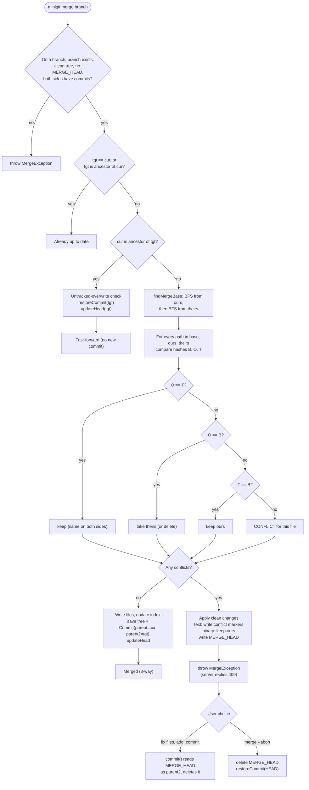

# Activity Diagram: Merge

How `Repository::merge` decides between up to date, fast-forward and a three-way merge, how each file is resolved using base (B), ours (O) and theirs (T), and how conflicts are finished or aborted.

Image version: [png/activity-merge.png](png/activity-merge.png)

[Back to all diagrams](README.md)
