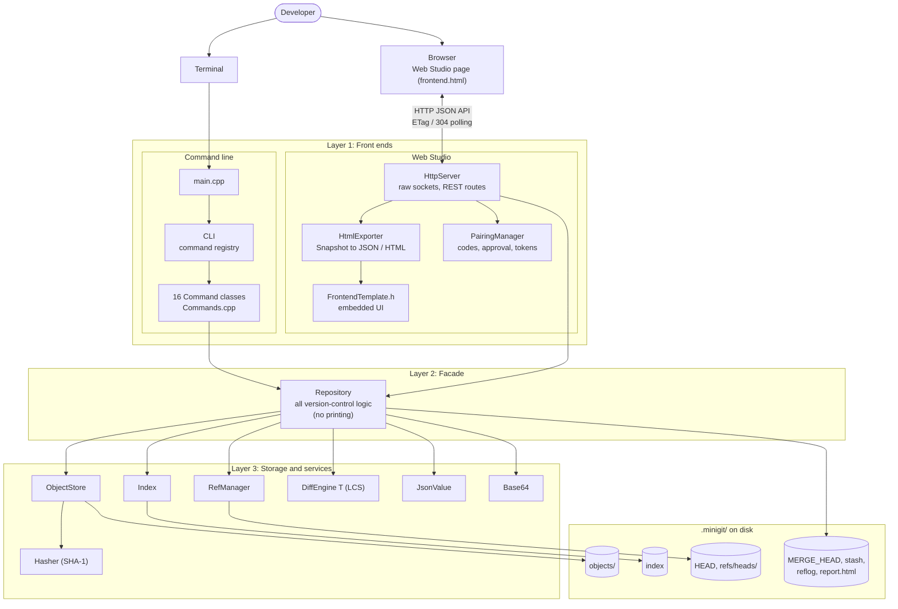

# Architecture Diagram

The three layers of Mini-Git: two front ends (command line and Web Studio) call one facade, `Repository`, which uses the storage classes and services that read and write `.minigit/`.

Image version: [png/architecture.png](png/architecture.png)

[Back to all diagrams](README.md)
