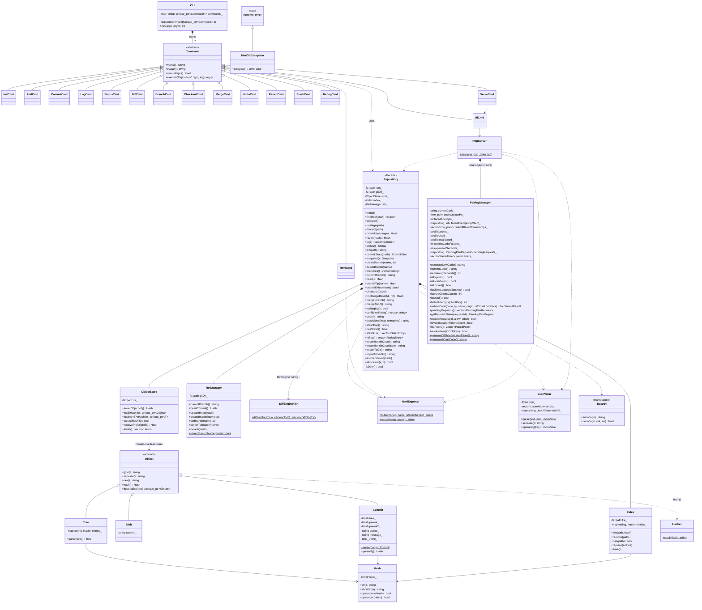

# Class Diagram (UML)

Every main class with its key members. Filled diamonds are composition (a part owned by its whole), hollow triangles are inheritance, dotted arrows are dependencies. Static members are underlined, abstract methods are in italics.

Image version: [png/class-diagram.png](png/class-diagram.png)

[Back to all diagrams](README.md)
