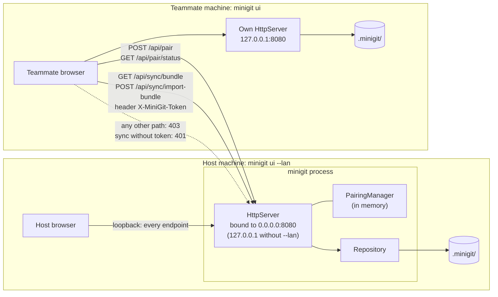

# Deployment Diagram

What runs where. Without `--lan` the server listens only on 127.0.0.1. With `--lan`, another machine can reach only the pairing and sync endpoints, and sync needs the session token.

Image version: [png/deployment.png](png/deployment.png)

[Back to all diagrams](README.md)
