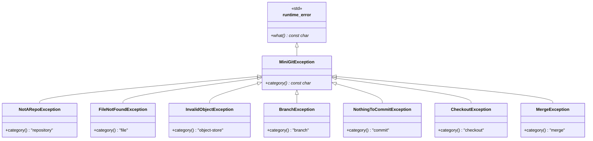

# Exception Hierarchy

All Mini-Git errors derive from `MiniGitException` (itself a `std::runtime_error`). Each subclass overrides `category()`, which the CLI prints as `error [category]: message` and the server turns into an HTTP error.

Image version: [png/exceptions.png](png/exceptions.png)

[Back to all diagrams](README.md)
