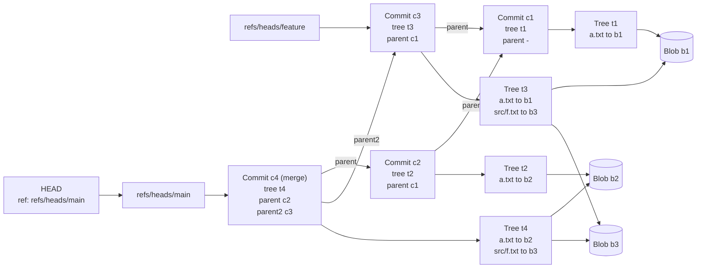

# Object Model

How stored objects point to each other: HEAD names a branch, a branch names a commit, a commit names its tree and parent(s), a tree maps paths to blobs. Identical content (blob b1, b3) is stored once and shared. c4 is a merge commit with `parent2`.

Image version: [png/object-model.png](png/object-model.png)

[Back to all diagrams](README.md)
