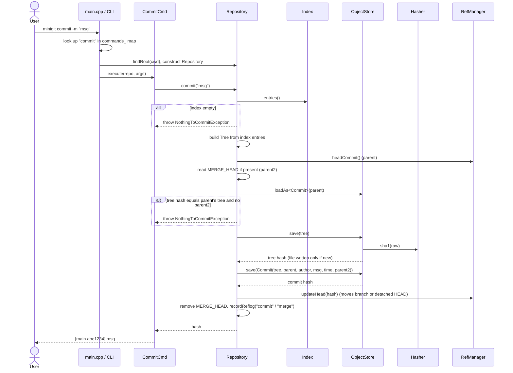

# Sequence Diagram: Commit

The calls made when the user runs `minigit commit -m "msg"`, from `main` down to the object store and refs.

Image version: [png/sequence-commit.png](png/sequence-commit.png)

[Back to all diagrams](README.md)
