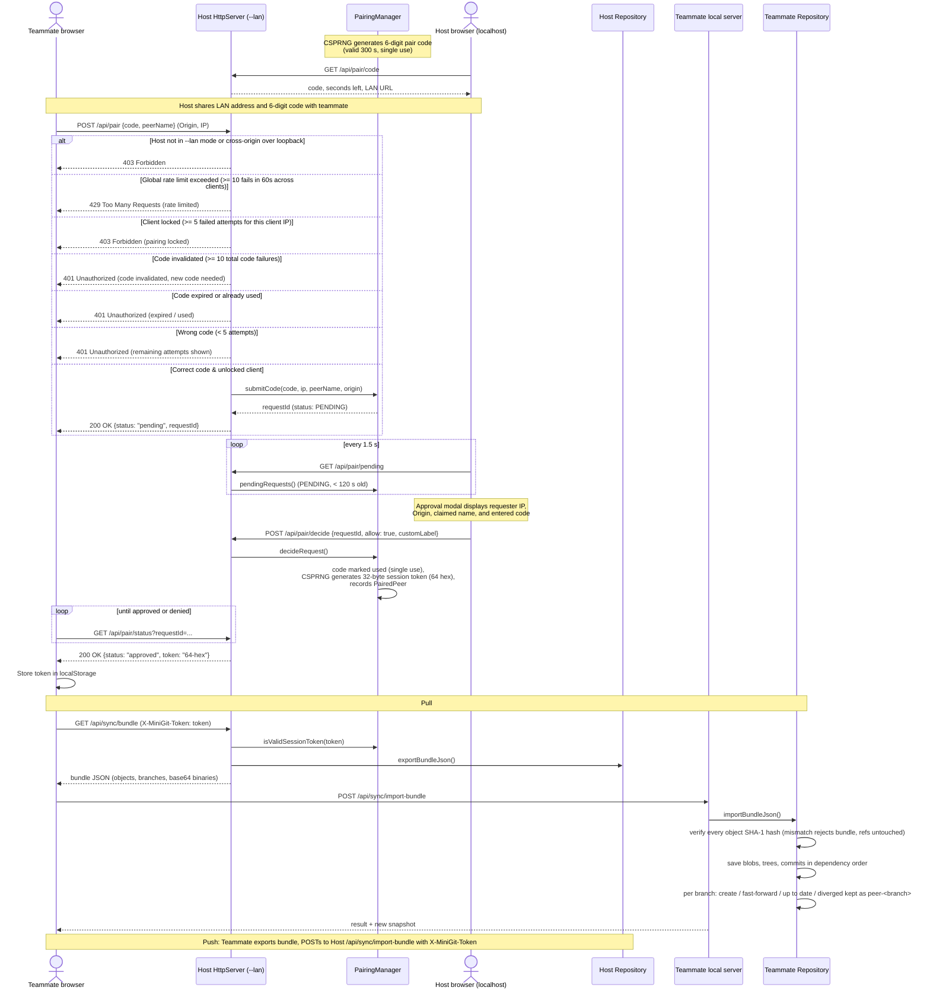

# Sequence Diagram: LAN Pairing and Sync

Pairing a teammate with a 6-digit code and host approval, then pulling the host's repository. Push is the same in reverse.

Image version: [png/sequence-pairing-sync.png](png/sequence-pairing-sync.png)

[Back to all diagrams](README.md)
