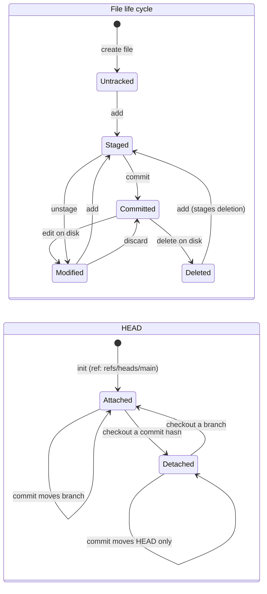

# State Diagrams

Left: the life cycle of a file (untracked, staged, committed, modified, deleted). Right: HEAD attached to a branch vs detached at a commit.

Image version: [png/state-diagram.png](png/state-diagram.png)

[Back to all diagrams](README.md)
